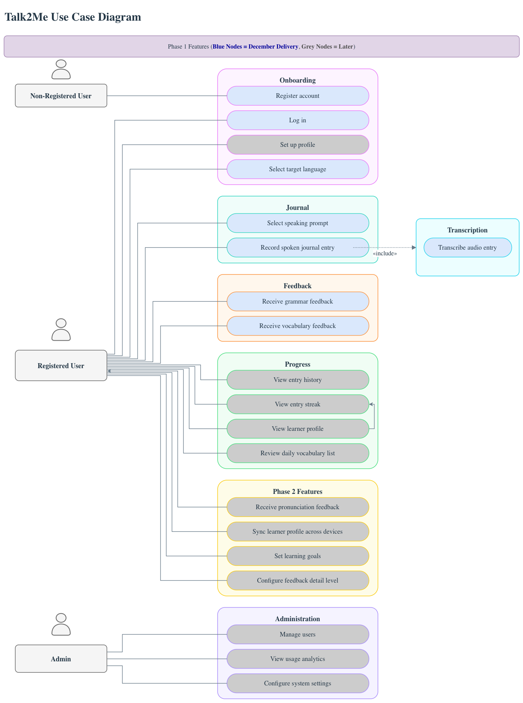

# Talk2Me

A mobile app that helps language learners build spoken fluency through a simple daily habit. Record a short spoken journal entry in your target language, receive AI-powered feedback on grammar and vocabulary, and build a personalised learner profile that improves with every session.

## Team

| Name | Role |
| ---- | ---- |
| Hope | Software Developer / Process Engineer / Designer |
| Rodrigo | Software Developer / Test Manager / User Researcher |

Blog: [talk2me4.wordpress.com](https://talk2me4.wordpress.com)

## Tech Stack

| Layer | Technology |
| ----- | ---------- |
| Mobile | Flutter (Dart) |
| Speech-to-Text | OpenAI Whisper (on-device) |
| AI Feedback | Anthropic Claude API |
| Local Storage | SQLite |
| Backend API | Python / FastAPI |
| Cloud | TBD (Railway / Render) |

## Project Status

Currently in the **Elaboration phase** (Week 5). Use case specifications and acceptance scenarios are complete. All step definitions are pending connection to the real application.

Phase 1 targets the core record-transcribe-feedback loop. Phase 2 adds personalisation, multi-language support, and cross-device sync.

## Repository Structure

```
talk2me/
  features/                         Gherkin feature files (one per use case)
    step_definitions/               Shared step definitions (all pending)
  scripts/
    check-features.cjs              Validates feature files against scenario map
  docs/
    use_cases/                      Use case specifications (UC-O01, UC-J01, UC-F01)
      assets/                       Activity diagrams and mockups
    acceptance-specifications/      Scenario mapping, step inventory, scenario-map.json
    diagrams/                       Use case diagram source and exports
  cucumber.cjs                      Cucumber configuration
  package.json                      npm scripts: bdd, bdd:dry-run, check
```

## Running the Acceptance Scenarios

```bash
npm install
npm run bdd:dry-run   # parse and list all scenarios without executing
npm run bdd           # run all scenarios (all pending until app is connected)
npm run check         # validate feature files against the scenario map
```

## Documentation

- [Software Requirements Specification](./docs/SoftwareRequirementsSpecification.md)
- [Use Case: Set Up a Learner Profile](./docs/use_cases/UC-O01_SetUpLearnerProfile.md)
- [Use Case: Record a Spoken Journal Entry](./docs/use_cases/UC-J01_RecordSpokenJournalEntry.md)
- [Use Case: Receive Language Feedback](./docs/use_cases/UC-F01_ReceiveLanguageFeedback.md)

## Overall Use Case Diagram


