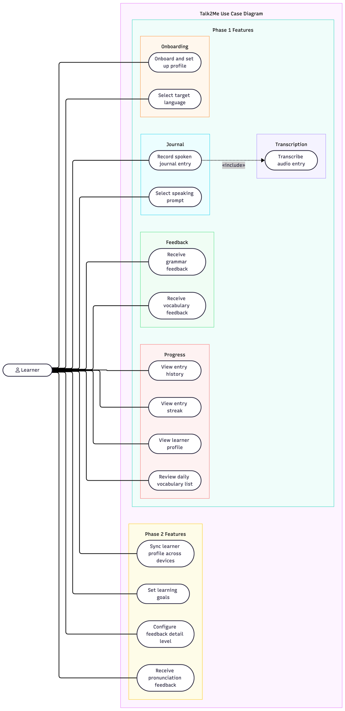

# Talk2Me

A mobile app that helps language learners build spoken fluency through a simple daily habit. Record a short spoken journal entry in your target language, receive AI-powered feedback on grammar and vocabulary, and build a personalised learner profile that improves with every session.

## Team

| Name | Role |
| ---- | ---- |
| Hope | Software Developer / Process Engineer / Designer |
| Rodrigo | Software Developer / Test Manager / User Researcher |

Blog: [talk2me4.wordpress.com](https://talk2me4.wordpress.com)

## Tech Stack

| Layer | Technology |
| ----- | ---------- |
| Mobile | Flutter (Dart) |
| Speech-to-Text | OpenAI Whisper (on-device) |
| AI Feedback | Anthropic Claude API |
| Local Storage | SQLite |
| Backend API | Python / FastAPI |
| Cloud | TBD (Railway / Render) |

## Project Status

Currently in the **Inception phase** (Week 3). The use case diagram and Software Requirements Specification are complete. User research is underway.

Phase 1 targets the core record-transcribe-feedback loop. Phase 2 adds personalisation, multi-language support, and cross-device sync.

## Repository Structure

```
talk2me/
  docs/
    SoftwareRequirementsSpecification.md   Full SRS
    use_case_diagram.svg                   Overall use case diagram (source)
    use_case_diagram.png                   Overall use case diagram (rendered)
```

Source code will be added as development begins in Phase 1.

## Documentation

- [Software Requirements Specification](./docs/SoftwareRequirementsSpecification.md)
- [Overall Use Case Diagram](./docs/use_case_diagram.svg)

## Overall Use Case Diagram


