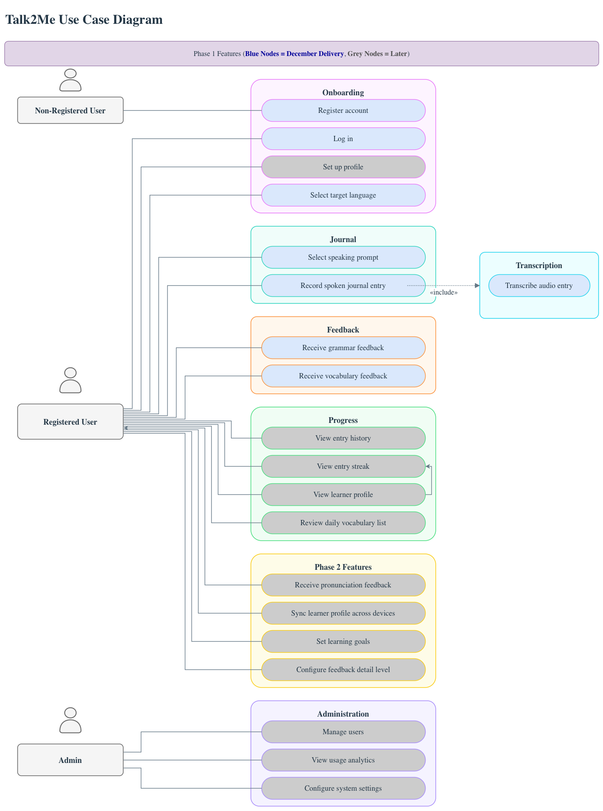

# Talk2Me

A mobile spoken-language journal: record an entry, transcribe it on-device, and request grammar and vocabulary feedback. Audio stays on the device; feedback uses the transcript and a compact learner-profile summary.

**Team:** Hope — development, process and design; Rodrigo — development, testing and user research.

[Blog](https://talk2me4.wordpress.com) · [YouTrack](https://talk2me.youtrack.cloud)

## Current status

Elaboration. This repository contains requirements, diagrams and 16 acceptance scenarios. The Cucumber step definitions are **pending**; they do not yet test a running Talk2Me app.

## Start reading

- [Software Requirements Specification](docs/SoftwareRequirementSpecification.md): scope, constraints and open decisions.
- [Software Architecture Document](docs/SoftwareArchitectureDocument.md): planned MVC structure, deployment and database model.
- [UC-O01 — Set up a learner profile](docs/use_cases/UC-O01_SetUpLearnerProfile.md).
- [UC-J01 — Record a spoken journal entry](docs/use_cases/UC-J01_RecordSpokenJournalEntry.md).
- [UC-F01 — Receive language feedback](docs/use_cases/UC-F01_ReceiveLanguageFeedback.md).
- [Scenario coverage](docs/acceptance-specifications/Scenario_Mapping.md) and [step-definition guide](docs/acceptance-specifications/Step_Inventory.md).

Each use case includes its mockup, activity diagram and link to the Gherkin source. Editable diagrams are beside their exports.

## Planned stack

Flutter/Dart mobile app, on-device Whisper, SQLite, and a Python/FastAPI backend calling Anthropic Claude. Hosting remains undecided. Cucumber.js is the acceptance-authoring scaffold, separate from the application stack.

## Check the acceptance specifications

Use a Node version supported by [package.json](package.json).

```bash
npm ci
npm run check
npm run bdd:dry-run
```

These commands check syntax, scenario mapping and step matching. `npm run bdd` executes the pending scaffold; a dry run is not proof of working application behaviour.


