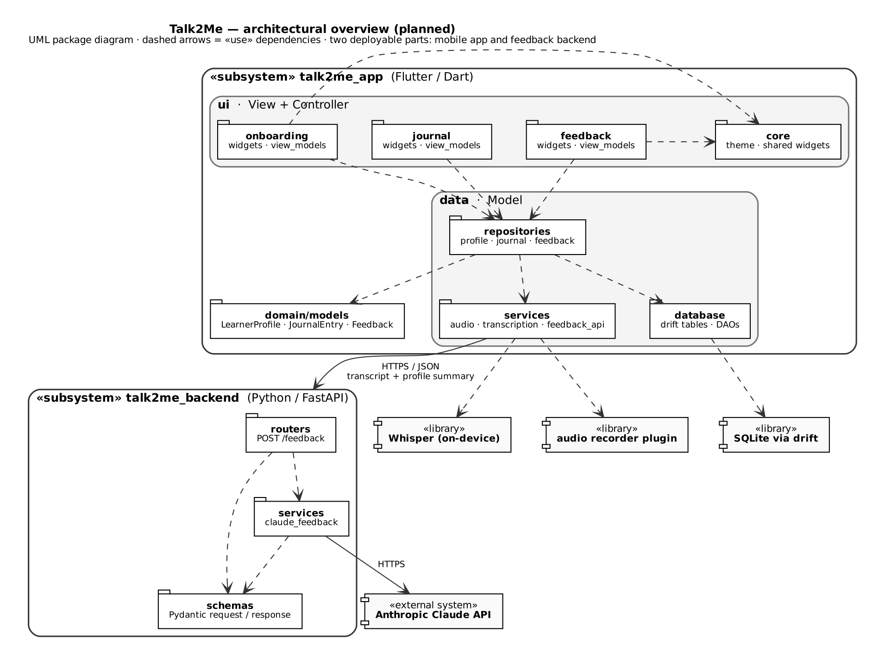
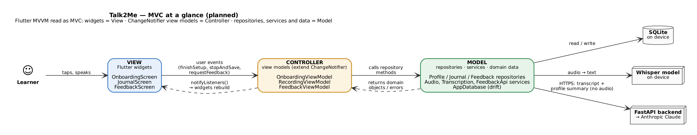
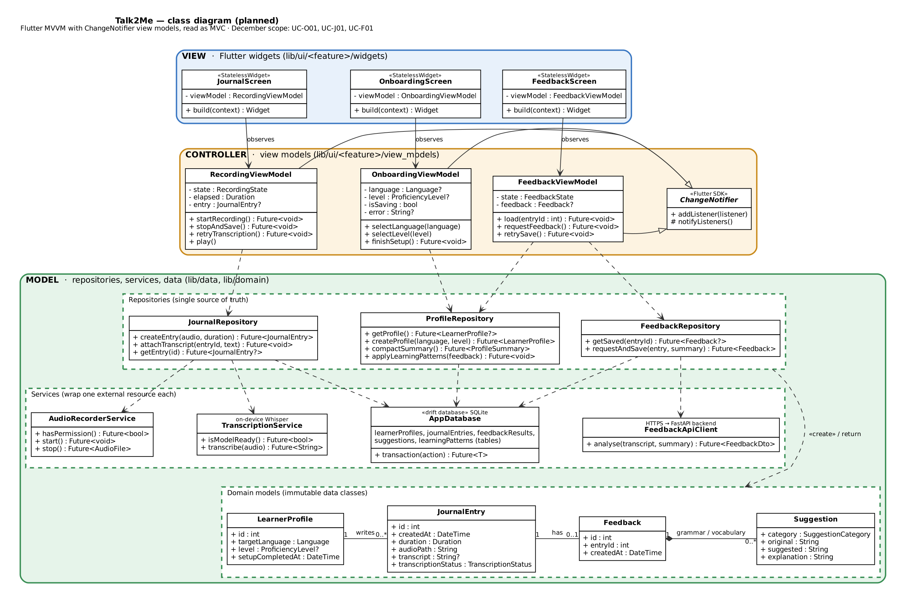
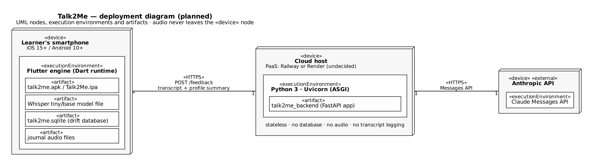
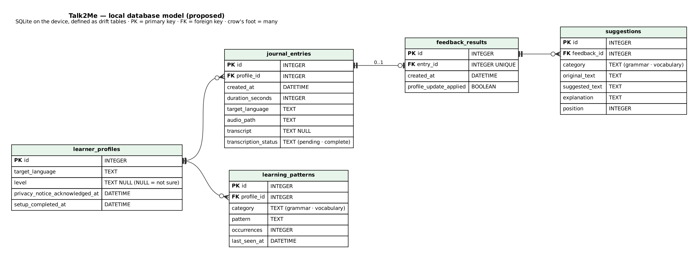

# Talk2Me — Software Architecture Document

Concise draft v0.1 · 24 November 2026 · Team: Hope and Rodrigo. Git records revision history. Follows the RUP Software Architecture Document outline. **No application code exists yet:** this document describes the planned architecture, not an implemented or measured system.

## 1. Introduction

### 1.1 Purpose

Give an architectural overview of Talk2Me from several views (use case, logical, deployment, data), and record the significant decisions behind them.

### 1.2 Scope

Covers the Flutter mobile app and the thin FastAPI feedback backend for the December delivery scope: [UC-O01](use_cases/UC-O01_SetUpLearnerProfile.md), [UC-J01](use_cases/UC-J01_RecordSpokenJournalEntry.md) and [UC-F01](use_cases/UC-F01_ReceiveLanguageFeedback.md). Product requirements live in the [SRS](SoftwareRequirementSpecification.md).

### 1.3 Terms

**SAD:** Software Architecture Document; **MVC:** Model–View–Controller; **MVVM:** Model–View–ViewModel; **ORM:** object-relational mapper; **CRUD:** Create, Read, Update, Delete; **STT:** speech-to-text; **PaaS:** platform as a service.

### 1.4 References

[SRS](SoftwareRequirementSpecification.md) · [Repository](https://github.com/hwnest25/talk2me) · [Blog](https://talk2me4.wordpress.com) · [Flutter app architecture guide](https://docs.flutter.dev/app-architecture/guide) · [drift](https://drift.simonbinder.eu/) · [FastAPI](https://fastapi.tiangolo.com/) · [RUP SAD template](http://sce.uhcl.edu/helm/RationalUnifiedProcess/wordtmpl/DOT/a_and_d/rup_sad.dot)

### 1.5 Overview

Section 2 explains MVC; section 3 how our tools realise it; section 4 the use-case view; section 5 the logical view; section 7 deployment; section 9 the data model. Sections 6, 8, 10 and 11 are not applicable at this stage.

## 2. Architectural Representation: Model–View–Controller

MVC splits an interactive application into three responsibilities:

| Part | Responsibility | Must not |
| --- | --- | --- |
| **Model** | Data, business rules and access to storage or external services. | Know about screens. |
| **View** | Presents model data and captures user input. | Contain business rules or storage logic. |
| **Controller** | Receives user events, calls the model, and decides what the view shows next. | Draw the interface or talk to storage directly. |

The benefit is separation of concerns: each part can change and be tested on its own. A redesigned screen does not touch storage, and a new database does not touch screens.

Flutter's official architecture guide recommends **MVVM**, a close variant of MVC. A *view model* plays the controller's role: it receives events from the view, calls the model, and exposes state. The difference is that the view *observes* the view model and rebuilds itself when notified, instead of the controller pushing updates to the view. We read MVVM as MVC throughout this document:

| MVC | Talk2Me (Flutter MVVM) |
| --- | --- |
| View | Flutter widgets (screens) |
| Controller | View models extending `ChangeNotifier` |
| Model | Repositories, services, domain data classes and the drift database |

The architecture is shown as a package diagram (overview), an MVC diagram (5.1), a class diagram (5.2), a UML deployment diagram (7) and a database model (9).

## 3. Architectural Goals, Constraints and Our MVC Tools

### 3.1 Goals and constraints

- **Privacy:** audio never leaves the device (SRS 3.6.1). Only the transcript and a compact profile summary are sent for feedback.
- **Device as source of truth:** profile, entries and history live in local SQLite; the backend is stateless (SRS 3.6.3).
- **Offline core:** recording, transcription and local storage work without a network (SRS 3.3.1).
- **Cross-platform:** one Flutter code base for iOS 15+ and Android 10+ (SRS 3.6.2).
- **Testability:** separate layers so the Cucumber scenarios can later be bound through view models and repositories.

### 3.2 Mobile app: Flutter with MVVM

Flutter is a UI toolkit, not an MVC framework, so the pattern comes from how we structure the code. We follow the official guide's layering:

- `lib/ui/<feature>/widgets` — **View.** Stateless screens that render view-model state.
- `lib/ui/<feature>/view_models` — **Controller.** One view model per screen, extending `ChangeNotifier`; calls `notifyListeners()` after each state change.
- `lib/data/repositories` — **Model.** The single source of truth for each kind of data; coordinate services and the database.
- `lib/data/services` — **Model.** Wrap one external resource each: audio recorder, on-device Whisper, the feedback API.
- `lib/domain/models` — **Model.** Immutable data classes shared across layers.

### 3.3 Backend: FastAPI

FastAPI is not an MVC framework either. The backend is a thin, stateless layer with one endpoint, `POST /feedback`. In MVC terms, the router function acts as controller, Pydantic request/response schemas are the model, and the JSON response is the view returned to the app.

### 3.4 Does our framework generate CRUD?

Not in the Rails or Django sense: neither Flutter nor FastAPI scaffolds screens, controllers and routes for a table.

The nearest equivalent is **drift**, the SQLite library we plan to use. Tables are declared as Dart classes; drift's code generator (`build_runner`) then produces typed row classes and the insert, select, update and delete API for each table. We will use this generated code inside the repositories. Repositories, view models and screens remain hand-written. The backend has no database, so it has no CRUD.

## 4. Use-Case View

Blue: product Phase 1 (December delivery). Purple: product Phase 2.

### 4.1 Use-case realisations

| Use case | View | Controller | Model |
| --- | --- | --- | --- |
| UC-O01 Set up a learner profile | `OnboardingScreen` | `OnboardingViewModel` | `ProfileRepository` → `AppDatabase` |
| UC-J01 Record a spoken journal entry | `JournalScreen` | `RecordingViewModel` | `JournalRepository` → `AudioRecorderService`, `TranscriptionService`, `AppDatabase` |
| UC-F01 Receive language feedback | `FeedbackScreen` | `FeedbackViewModel` | `FeedbackRepository` → `FeedbackApiClient`, `AppDatabase`; `ProfileRepository` for the summary and learning patterns |

## 5. Logical View

### 5.1 MVC high-level diagram

1. The learner taps or speaks; the **View** forwards the event to its view model.
2. The **Controller** (view model) calls a repository method.
3. The **Model** reads or writes SQLite, runs Whisper on the device, or calls the backend, then returns domain objects or an error.
4. The view model updates its state and calls `notifyListeners()`; the widgets rebuild.

### 5.2 Class diagram with MVC sections

- **View (blue):** three screens, each holding one view model.
- **Controller (amber):** three view models, all specialising `ChangeNotifier`.
- **Model (green):** repositories, services, the drift `AppDatabase` and the domain classes.

Class and method names are planned, not implemented. Because no code exists yet, there is no code-generated UML diagram to overlay this design on. Once `lib/` exists, we plan to generate one (candidates: `dcdg` for Dart, `pyreverse` for the backend) and compare it with this diagram.

## 6. Process View

Not applicable: Talk2Me has no architecturally significant concurrency beyond Dart's asynchronous calls.

## 7. Deployment View

| Node | Deployed artifacts | Notes |
| --- | --- | --- |
| Learner's smartphone «device» | Talk2Me app, Whisper tiny/base model, `talk2me.sqlite`, journal audio files | Runs fully offline except for new feedback requests |
| Cloud host «device» | `talk2me_backend` (FastAPI on Uvicorn) | PaaS still undecided: Railway or Render. Stateless; no database, audio or transcript logging |
| Anthropic API «external» | Claude Messages API | Receives the transcript and profile summary from the backend only |

Both communication paths use HTTPS. Nothing is deployed yet.

## 8. Implementation View

Not applicable yet: no implementation exists. The planned package layout appears in section 3.2 and the overview diagram.

## 9. Data View

Proposed SQLite schema, defined as drift tables on the device:

| Table | Purpose | Key rules |
| --- | --- | --- |
| `learner_profiles` | The one local profile (UC-O01) | `level` is NULL for **Not sure** |
| `journal_entries` | One row per saved recording (UC-J01) | `transcription_status`: pending or complete |
| `feedback_results` | One feedback result per entry (UC-F01) | `entry_id` UNIQUE: one result only; `profile_update_applied` prevents a repeated profile update |
| `suggestions` | Grammar and vocabulary items of a result | An empty list is valid (UC-F01 A5) |
| `learning_patterns` | Error profile used for later personalisation | Updated once per new feedback result |

Writes that change several tables (profile setup, saving feedback with its profile update) run in one transaction (SRS 3.3.2). The daily vocabulary list and streaks (Phase 1 later) are not yet modelled.

## 10. Size and Performance

Not covered here; inherited targets are in SRS 3.4 and remain unmeasured.

## 11. Quality

Not covered here; see SRS sections 3.2–3.5.

## Diagram sources

Every diagram has a Graphviz source beside its export in [`architecture/`](architecture/). Regenerate with `dot -Tpng -Gdpi=150 <name>.dot -o <name>.png`.
