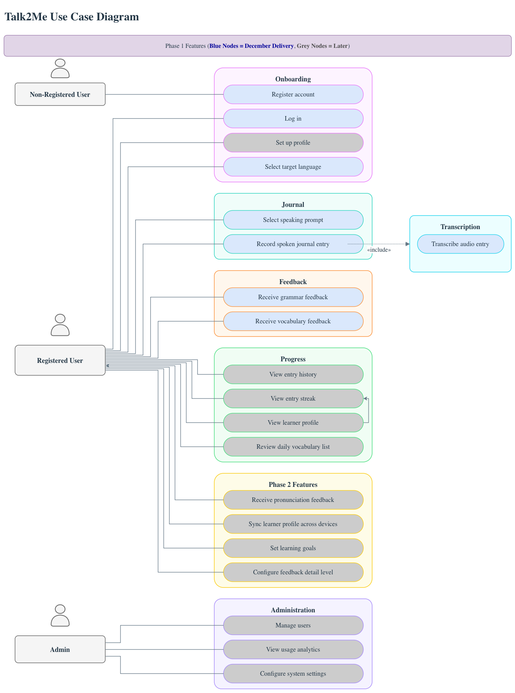

# Talk2Me — Software Requirements Specification

Concise draft · 11 November 2026 · Team: Hope and Rodrigo. Git records revision history. Requirements below describe intended behaviour, not implemented or measured results.

## 1. Introduction

### 1.1 Purpose

Define Talk2Me's scope, functional goals, quality requirements and constraints. Detailed interaction flows belong in the linked use cases.

### 1.2 Scope

An iOS/Android app helps a **Learner** practise speaking through daily journals of 30 seconds to two minutes. It records and transcribes audio on-device, then sends text and a compact profile summary for AI grammar/vocabulary feedback. Audio stays local.

The broader vision includes personalisation, vocabulary practice, prompts and progress tracking. Professional domain tracks, enterprise use, pronunciation analysis and cross-device sync are later work.

### 1.3 Terms

**SRS:** Software Requirements Specification; **UC:** use case; **UCD:** use-case diagram; **STT:** speech-to-text; **MVP:** minimum viable product; **PRD:** product requirements document.

### 1.4 References

[Repository](https://github.com/hwnest25/talk2me) · [Blog](https://talk2me4.wordpress.com) · [Whisper](https://github.com/openai/whisper) · [Claude documentation](https://docs.anthropic.com)

### 1.5 Overview

Section 2 describes the product and stack; section 3 defines requirements; section 4 lists unresolved decisions.

## 2. Overall Description

### 2.1 Vision

Make short, frequent speaking practice accessible without arranging a tutor. Build a local learner profile from error patterns, vocabulary gaps, fluency scores and session history, and use it to personalise later feedback.

“Phase 1/2” below means **product delivery scope**, not the RUP phases Inception/Elaboration/Construction/Transition used in YouTrack.

### 2.2 Use Case Diagram

Blue: product Phase 1. Purple: product Phase 2.

### 2.3 Technology Stack

| Component | Planned choice |
| --- | --- |
| Mobile | Flutter / Dart |
| Transcription | On-device Whisper tiny/base |
| Local data | SQLite: entries, profile and history |
| Feedback | Anthropic Claude API |
| Backend | Python / FastAPI; stateless where possible |
| Hosting | Undecided: Railway or Render considered |
| Collaboration | YouTrack, GitHub and draw.io |

## 3. Specific Requirements

### 3.1 Functionality

| ID | User goal | Delivery scope / specification |
| --- | --- | --- |
| 3.1.1 | Onboard and set up profile | December — [UC-O01](use_cases/UC-O01_SetUpLearnerProfile.md) |
| 3.1.2 | Record spoken journal entry | December — [UC-J01](use_cases/UC-J01_RecordSpokenJournalEntry.md) |
| 3.1.3 | Transcribe audio entry | December — included in UC-J01 |
| 3.1.4 | Receive grammar feedback | December — [UC-F01](use_cases/UC-F01_ReceiveLanguageFeedback.md) |
| 3.1.5 | Receive vocabulary feedback | December — UC-F01 |
| 3.1.6 | View entry history | Wider product Phase 1 |
| 3.1.7 | View learner profile | Wider product Phase 1 |
| 3.1.8 | Review daily vocabulary drawn from the learner's errors and level progression, shown each session | Wider product Phase 1 |
| 3.1.9 | View entry streak | Wider product Phase 1 |
| 3.1.10 | Select a speaking prompt at the start of a session | Wider product Phase 1 |
| 3.1.11 | Select target language | Wider product Phase 1 |
| 3.1.12 | Sync profile across devices | Product Phase 2 |
| 3.1.13 | Set learning goals | Product Phase 2 |
| 3.1.14 | Configure feedback detail level | Product Phase 2 |
| 3.1.15 | Receive pronunciation feedback | Product Phase 2 |

The three detailed UCs contain mockups, activity diagrams and links to Gherkin narratives. Their registered steps remain pending application integration.

### 3.2 Usability

- **3.2.1:** Complete onboarding and a first recording within two minutes of installation, without external account creation.
- **3.2.2:** Explain feedback in plain language; show original wording alongside grammar corrections.
- **3.2.3:** Minimum completed recording: 30 seconds. Make short entries feel achievable.

### 3.3 Reliability

- **3.3.1:** Recording, transcription and local storage work offline. Network loss during AI feedback must not crash the app or lose data.
- **3.3.2:** Preserve entries, profile and vocabulary history through crashes/termination; use transactional SQLite writes. Recovery limits require testing.

### 3.4 Performance

- **3.4.1:** Transcribe a two-minute recording within 10 seconds on a 2022-or-later device.
- **3.4.2:** Display feedback within eight seconds of transcript submission under normal network conditions.
- **3.4.3:** Combined app/model footprint: at most 200 MB for product Phase 1.

These are inherited targets, not benchmark results.

### 3.5 Supportability

- **3.5.1:** Follow the Dart style guide and PEP 8; use clear domain-based names.
- **3.5.2:** Unit-test recording, transcription and feedback; integration-test profile updates. UI testing is deferred to product Phase 2.
- **3.5.3:** Version code and documentation in GitHub with meaningful commits. Keep one authoritative source for each piece of documentation.

### 3.6 Design Constraints

- **3.6.1:** Audio never leaves the device in the current scope. Any future cloud STT option would require explicit opt-in and a separately reviewed scope change.
- **3.6.2:** Flutter frontend; iOS 15+ and Android 10+.
- **3.6.3:** The device is the source of truth for profile data. Keep the backend stateless where possible; opt-in server-side sync is deferred.

### 3.7 User Help

Product Phase 1 has self-explanatory onboarding; an in-app help section is deferred to Phase 2.

### 3.8 Components

No purchased components are currently specified. Whisper is open source; Claude is a pay-per-use service.

### 3.9 Interfaces

- **3.9.1 UI:** Onboarding (language, level, privacy notice); record/home (prompt, record, streak); feedback (grammar, vocabulary, register, fluency); entry history; profile; daily vocabulary; settings (language, notifications). The original onboarding list also included goals: see the scope conflict below.
- **3.9.2 Hardware:** Microphone and local storage for SQLite/model files.
- **3.9.3 Software:** Whisper maps local audio to text. Claude receives transcript/profile summary and returns structured JSON feedback.
- **3.9.4 Communication:** HTTPS for backend calls; no audio transmission.

### 3.10 Licensing

Licensing requirements remain to be decided.

### 3.11 Privacy and Notices

Audio remains exclusively on-device. The Talk2Me backend must process submitted transcripts only for feedback, without logging or retaining them, then discard them. Onboarding explains this flow and advises learners not to include sensitive personal information. External-provider retention settings must be checked before deployment.

The app must offer full data deletion at any time. GDPR compliance remains a product requirement, not a verified claim.

### 3.12 Standards

Dart style guide, PEP 8, UML 2.x and GDPR requirements for data handling/erasure.

## 4. Open Decisions

- Confirm initial supported languages and level choices, including **Not sure**.
- The SRS assigns learning goals to Phase 2 but originally mentions them in onboarding. UC-O01 currently defers them.
- Confirm UC-J01's proposed two-minute automatic stop and UC-F01's explicit feedback request.
- Align the overall diagram's separate grammar/vocabulary goals with the combined UC-F01; the December mockup also omits register/fluency scores shown in the broader UI list.
- Check on-device performance, model footprint, crash recovery and provider retention before claiming the targets are met.
