# Talk2Me — Software Requirements Specification

## Table of Contents
- [Table of Contents](#table-of-contents)
- [Introduction](#1-introduction)
    - [Purpose](#11-purpose)
    - [Scope](#12-scope)
    - [Definitions, Acronyms and Abbreviations](#13-definitions-acronyms-and-abbreviations)
    - [References](#14-references)
    - [Overview](#15-overview)
- [Overall Description](#2-overall-description)
    - [Vision](#21-vision)
    - [Use Case Diagram](#22-use-case-diagram)
    - [Technology Stack](#23-technology-stack)
- [Specific Requirements](#3-specific-requirements)
    - [Functionality](#31-functionality)
    - [Usability](#32-usability)
    - [Reliability](#33-reliability)
    - [Performance](#34-performance)
    - [Supportability](#35-supportability)
    - [Design Constraints](#36-design-constraints)
    - [Online User Documentation and Help System Requirements](#37-online-user-documentation-and-help-system-requirements)
    - [Purchased Components](#38-purchased-components)
    - [Interfaces](#39-interfaces)
    - [Licensing Requirements](#310-licensing-requirements)
    - [Legal, Copyright and Other Notices](#311-legal-copyright-and-other-notices)
    - [Applicable Standards](#312-applicable-standards)
- [Supporting Information](#4-supporting-information)

---

## 1. Introduction

### 1.1 Purpose
This Software Requirements Specification (SRS) describes all specifications for the application "Talk2Me". It includes an overview of the project and its vision, the use case diagram covering the full product scope, and the non-functional requirements and constraints that govern development. Functional requirements detail for individual use cases will be documented separately in linked use case files as development progresses.

### 1.2 Scope
Talk2Me is a cross-platform mobile application (iOS and Android) that helps language learners build spoken fluency through a daily journaling habit. The learner records a short spoken entry in their target language, receives structured AI-powered feedback on grammar and vocabulary, and builds a personalised learner profile that improves with every session.

Actors of this application:
- **Learner:** The primary user. Records entries, receives feedback, tracks progress.

Planned subsystems:

- **Recording and Transcription:** The learner records a spoken journal entry. Audio is transcribed on-device using OpenAI Whisper. No audio leaves the device at any point.
- **AI Feedback Engine:** The transcript and a compact learner profile summary are sent to the backend, which calls the Anthropic Claude API and returns structured feedback on grammar errors, vocabulary suggestions, and register assessment.
- **Learner Profile:** A locally stored profile (SQLite) that accumulates error patterns, vocabulary gaps, fluency scores, and session history. Used to personalise feedback over time.
- **Daily Vocabulary List:** A generated list of vocabulary items drawn from the learner's own errors and level-appropriate progression, surfaced each session.
- **Prompt Suggestions:** A set of speaking prompts offered to the learner at the start of each session to reduce friction.
- **Streak and Progress Tracking:** Session streaks and basic progress indicators to support habit formation.

### 1.3 Definitions, Acronyms and Abbreviations

| Abbreviation | Explanation |
| ------------ | ----------- |
| SRS | Software Requirements Specification |
| UC | Use Case |
| UCD | Overall Use Case Diagram |
| n/a | Not applicable |
| tbd | To be determined |
| STT | Speech-to-Text |
| API | Application Programming Interface |
| SQLite | Lightweight relational database for on-device storage |
| RUP | Rational Unified Process |
| PRD | Product Requirements Document |
| MVP | Minimum Viable Product |

### 1.4 References

| Title | Date | Publishing Organisation |
| ----- |:----:| ----------------------- |
| [Talk2Me Blog](https://talk2me4.wordpress.com) | October 2026 | Talk2Me Team |
| [Talk2Me GitHub Repository](https://github.com/hwnest25/talk2me) | October 2026 | Talk2Me Team |
| [Anthropic Claude API Documentation](https://docs.anthropic.com) | 2026 | Anthropic |
| [OpenAI Whisper](https://github.com/openai/whisper) | 2026 | OpenAI |

### 1.5 Overview
The following chapter provides an overall description of the project including the product vision and the Overall Use Case Diagram. Chapter 3 specifies non-functional requirements covering usability, reliability, performance, supportability, and design constraints. Chapter 4 provides supporting information.

---

## 2. Overall Description

### 2.1 Vision
Speaking is the hardest language skill to practice and the most neglected. Most apps focus on reading, listening, and vocabulary drills. Consistent speaking practice has traditionally required a human tutor, which is expensive and hard to schedule. The result: most learners avoid it entirely, which is why they plateau.

Talk2Me addresses this with a simple daily habit. The learner speaks for 30 seconds to 2 minutes in their target language, receives structured AI feedback on grammar, vocabulary, and register, and builds a personalised error profile that makes every session smarter than the last. Audio never leaves the device. Only the text transcript and a compact learner profile summary are transmitted for analysis.

The full vision includes professional domain tracks (medicine, law, aviation), cross-device sync, pronunciation analysis, and enterprise features for institutional learners. Phase 1 focuses on validating the core loop with individual learners.

### 2.2 Use Case Diagram

- **Green:** Planned for Phase 1
- **Yellow:** Planned for Phase 2

### 2.3 Technology Stack

**Mobile Frontend:**
- Flutter (Dart) — cross-platform iOS and Android from a single codebase

**Speech-to-Text:**
- OpenAI Whisper (on-device, tiny/base model) — no audio egress

**AI Feedback:**
- Anthropic Claude API — structured grammar, vocabulary, and register feedback

**Local Storage:**
- SQLite — learner profile, entry history, error patterns stored on-device

**Backend API:**
- Python / FastAPI — thin stateless layer handling Claude integration and prompt delivery

**Cloud Infrastructure:**
- TBD (Railway or Render for Phase 1)

**Project Management:**
- YouTrack
- GitHub
- draw.io (UML diagrams)

---

## 3. Specific Requirements

### 3.1 Functionality
This section lists the use cases visible in the Overall Use Case Diagram. Functional requirement detail for each use case will be added in linked use case documents as implementation progresses.

**Phase 1 — planned for implementation:**
- 3.1.1 Onboard and set up profile
- 3.1.2 Record spoken journal entry
- 3.1.3 Transcribe audio entry *(included in 3.1.2)*
- 3.1.4 Receive grammar feedback
- 3.1.5 Receive vocabulary feedback
- 3.1.6 View entry history
- 3.1.7 View learner profile
- 3.1.8 Review daily vocabulary list
- 3.1.9 View entry streak
- 3.1.10 Select speaking prompt
- 3.1.11 Select target language

**Phase 2 — deferred:**
- 3.1.12 Sync learner profile across devices
- 3.1.13 Set learning goals
- 3.1.14 Configure feedback detail level
- 3.1.15 Receive pronunciation feedback

### 3.2 Usability

#### 3.2.1 Minimal friction to first session
A new user must be able to complete onboarding and record their first entry within 2 minutes of installing the app, without requiring any external account creation.

#### 3.2.2 Accessible feedback presentation
AI feedback must be presented in plain language without linguistic jargon. Grammar corrections must show the original phrasing alongside the corrected version.

#### 3.2.3 Short minimum entry time
The minimum recording length is 30 seconds. The interface must not discourage short entries — the habit must feel achievable daily.

### 3.3 Reliability

#### 3.3.1 Offline core functionality
Recording, transcription, and local storage must function fully offline. AI feedback requires a network connection but the app must not crash or lose data if the connection is unavailable.

#### 3.3.2 Data integrity
No entry data, learner profile, or vocabulary history may be lost due to app crashes or unexpected termination. All writes to SQLite must be transactional.

### 3.4 Performance

#### 3.4.1 Transcription latency
On-device Whisper transcription of a 2-minute entry must complete within 10 seconds on a 2022 or later device.

#### 3.4.2 Feedback response time
End-to-end feedback (transcript submission to result displayed) must complete within 8 seconds under normal network conditions.

#### 3.4.3 Storage footprint
The Whisper model and app combined must not exceed 200 MB of device storage for Phase 1.

### 3.5 Supportability

#### 3.5.1 Coding standards
All Dart/Flutter code must follow the official Dart style guide. All Python backend code must follow PEP 8. Variable and function names must be descriptive and consistent with domain vocabulary.

#### 3.5.2 Testing strategy
Core use cases (recording, transcription, feedback) must have unit tests. The learner profile update logic must have integration tests. UI testing is deferred to Phase 2.

#### 3.5.3 Version control
All code and documentation must be committed to GitHub with meaningful commit messages. Documentation must not be duplicated across files — the DRY principle applies to documentation as well as code.

### 3.6 Design Constraints

#### 3.6.1 Privacy constraint
Audio must never leave the device. This is a hard architectural constraint, not a policy. The transcription layer must be implemented on-device. Any future cloud STT option must require explicit user opt-in.

#### 3.6.2 Platform constraint
Phase 1 targets iOS 15+ and Android 10+. Flutter is the mandated framework for the mobile frontend.

#### 3.6.3 Architecture constraint
The backend must be stateless where possible. The device holds the source of truth for the learner profile. Server-side storage of profile data is deferred to Phase 2 opt-in sync.

### 3.7 Online User Documentation and Help System Requirements
Phase 1 will not include in-app documentation. Onboarding screens must be self-explanatory. A help section is deferred to Phase 2.

### 3.8 Purchased Components
No purchased components at this stage. The following third-party services are used under free or pay-per-use models:
- Anthropic Claude API (pay-per-token)
- OpenAI Whisper (open source, on-device)

### 3.9 Interfaces

#### 3.9.1 User Interfaces
- **Onboarding screens** — language selection, level self-assessment, goal setting
- **Home / record screen** — primary entry point, prompt display, record button, streak indicator
- **Feedback screen** — grammar corrections, vocabulary suggestions, register note, fluency score
- **Entry history screen** — list of past entries with dates and scores
- **Learner profile screen** — error patterns, vocabulary progress, cumulative stats
- **Daily vocabulary screen** — vocabulary items drawn from errors and level progression
- **Settings screen** — target language, notification preferences

#### 3.9.2 Hardware Interfaces
- Device microphone (required for recording)
- Local storage (required for SQLite and Whisper model)

#### 3.9.3 Software Interfaces
- Anthropic Claude API — receives transcript and learner profile summary; returns structured JSON feedback
- OpenAI Whisper (on-device) — receives audio file; returns text transcript

#### 3.9.4 Communication Interfaces
- HTTPS for all backend communication
- No audio transmitted over any network interface

### 3.10 Licensing Requirements
tbd

### 3.11 Legal, Copyright and Other Notices
User audio recordings remain exclusively on the user's device and are never transmitted or stored externally. Learner profile data transmitted to the backend for AI processing is ephemeral and not logged or retained server-side. Full data deletion must be available to the user at any time in compliance with GDPR.

### 3.12 Applicable Standards
- Dart style guide (Flutter development)
- PEP 8 (Python backend)
- UML 2.x (use case diagrams)
- GDPR (data handling and right to erasure)

---

## 4. Supporting Information
For further information, visit the [Talk2Me Blog](https://talk2me4.wordpress.com) or contact the team via the repository.

The team:
- Hope Wilson
- Rodrigo Chavez
