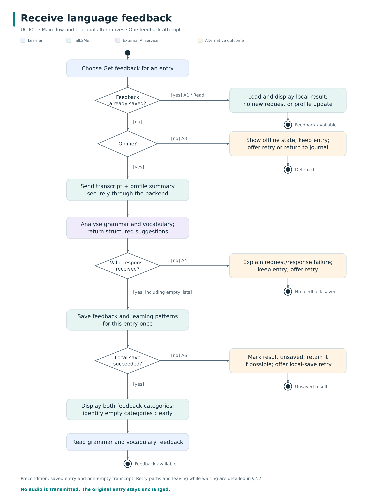
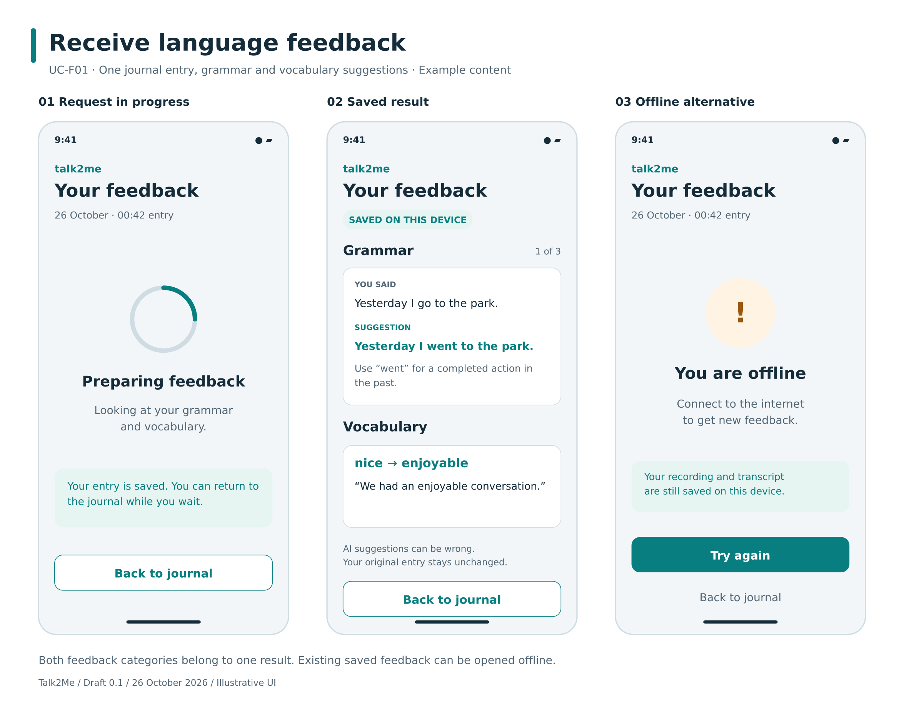

# Talk2Me — Use-Case Specification

**UC-F01: Receive language feedback**  
Version 0.1 — draft for team review

## Revision History

| Date | Version | Description | Prepared by |
| --- | --- | --- | --- |
| 2026-10-26 | 0.1 | Initial specification and visuals; not committed to Git | ChatGPT, for Team Talk2Me |

## 1. Use-Case Name

**Receive language feedback**

| Field | Definition |
| --- | --- |
| Identifier | UC-F01 |
| Primary actor | Learner who has completed local onboarding |
| Supporting actor | External AI feedback service (Anthropic Claude) |
| Goal | Obtain understandable grammar and vocabulary feedback for one journal entry |
| Trigger | The learner chooses **Get feedback** for an entry |
| Scope | Talk2Me app and backend; December delivery |
| CRUD | **Not a simple CRUD use case.** It requests analysis and presents suggestions. A1 retrieves an existing result (**Read / R**); storing a new result is a supporting data operation. |
| SRS traceability | [SRS 3.1.4 and 3.1.5](https://github.com/hwnest25/talk2me/blob/4d7918c4c9cb7bd1a3835e42831891c7c35e274f/docs/SoftwareRequirementsSpecification.md#31-functionality) |

Grammar and vocabulary are two parts of the same feedback result, not two unrelated user goals. This draft groups them in one specification while retaining their separate SRS references. A future SRS/diagram alignment is recorded in [the review](../../REVIEW.md). Pronunciation assessment, history browsing, and changing feedback settings are outside this goal.

### 1.1 Brief Description

Deferred until the `.feature` work, as permitted by the assignment.

## 2. Flow of Events

### 2.1 Basic Flow

1. The learner chooses **Get feedback** for the current saved entry.
2. Talk2Me confirms that a non-empty transcript and local learner profile are available. In this main flow, no feedback is already saved for this entry.
3. Talk2Me checks connectivity and displays that feedback is being prepared. It prevents duplicate submissions for this entry while a request is active.
4. Talk2Me sends the transcript and a compact learner-profile summary securely to its backend. The backend requests grammar and vocabulary analysis from the external AI service. Audio remains on the device.
5. The service returns structured feedback. Talk2Me checks that the response contains both expected categories and usable data; empty suggestion lists are valid.
6. Talk2Me saves the validated feedback against the entry on the device and records returned learning patterns in the local profile once. It marks feedback as available.
7. Talk2Me displays grammar suggestions with original wording, suggested corrections, and plain-language explanations. It also displays vocabulary suggestions with their context or example usage. An empty category is explicitly described as having no suggestions returned.
8. The learner reads the feedback. The use case ends successfully; the recording and original transcript are unchanged.

The explicit request and joint grammar/vocabulary result are draft design decisions; see [review assumptions A2–A3](../../REVIEW.md#design-decisions-and-assumptions).

#### 2.1.1 Activity Diagram

[Editable SVG](assets/UC-F01_activity.svg)

The diagram includes existing feedback, offline use, response failures, and local-save recovery. Further alternatives are described below.

#### 2.1.2 Mockup

[Editable SVG](assets/UC-F01_mockup.svg)

The example language and suggestions are illustrative, not survey findings or actual model output. Suggestions are read-only and do not overwrite the learner's transcript. Pronunciation scores, register assessment, and fluency scores are not included in this narrower December mockup.

### 2.2 Alternative Flows

#### 2.2.1 A1 — Feedback already exists (Read / R)

At step 2, Talk2Me loads the saved feedback for this entry and continues at step 7. No network connection, new AI request, or further learner-profile update is needed.

#### 2.2.2 A2 — Transcript is missing

At step 2, Talk2Me explains that transcription must finish first. The learner returns to the saved entry and can use the transcription recovery path in [UC-J01](UC-J01_RecordSpokenJournalEntry.md). No AI request is made and this attempt ends without feedback.

#### 2.2.3 A3 — Device is offline

At step 3, Talk2Me explains that new feedback requires internet access. The saved recording and transcript remain available. The learner can retry the connectivity check or leave and request feedback later. No automatic background submission is assumed.

#### 2.2.4 A4 — Request fails, times out, or returns unusable data

At step 4 or 5, Talk2Me distinguishes a service/network failure from a successful result with no suggestions. It retains the original entry and offers **Try again** or **Back to journal**. Retrying returns to step 3 for the same entry. Only one accepted result updates the local profile; an obsolete late response must not replace that result or attach to another entry.

#### 2.2.5 A5 — No suggestions are returned

At step 5, a valid response may contain no grammar corrections, no vocabulary suggestions, or neither. Talk2Me continues at step 6 and shows the empty categories clearly. It does not invent corrections or claim that the learner's speech is error-free.

#### 2.2.6 A6 — Saving the feedback fails

At step 6, Talk2Me retains the received result temporarily where possible, marks it as not saved, and offers another local save attempt. Retrying step 6 does not send a new AI request. The original entry and previously saved profile remain intact. If the unsaved result is lost after termination, another request may be necessary; the app must not claim that it was stored.

#### 2.2.7 A7 — Learner leaves while waiting

After submission, the learner can return to the journal. If the request completes while the app remains active, Talk2Me saves the result to the originating entry. If the request cannot finish, the entry remains without available feedback and can be retried later. Returning to a saved result follows A1. Leaving the screen does not retract text already transmitted.

## 3. Special Requirements

- **Privacy:** Only the transcript and compact profile summary are transmitted, over HTTPS. No audio is sent. The Talk2Me backend must not log or retain submitted text after processing, per SRS 3.6.1, 3.9.4 and 3.11. External-provider retention settings need verification before deployment; this specification is not proof of provider behaviour.
- **Understandability:** Show original wording next to corrections and use plain-language explanations, per SRS 3.2.2. Present AI output as suggestions, not guaranteed facts.
- **Performance target:** Display feedback within 8 seconds of transcript submission under normal network conditions, per SRS 3.4.2. This target is not a measured result or an automatic timeout threshold. Keep a visible pending state if processing takes longer.
- **Reliability:** Preserve local entries during offline use or service failure. Save feedback and corresponding profile changes consistently, and avoid duplicate profile updates. SRS 3.3.1–3.3.2.
- **Content limits:** This use case analyses text. It must not claim to assess pronunciation from the transcript. The original recording and transcript are never silently rewritten.

## 4. Preconditions

1. The learner has completed local onboarding and has a local profile.
2. A locally saved entry with a non-empty transcript exists. A2 covers a stale or invalid entry state.
3. Onboarding has explained that text and a compact profile summary are sent for feedback and that audio stays local.

An external account is not required. Connectivity is checked during the flow because saved feedback can be read offline.

## 5. Postconditions

### 5.1 Success

Grammar and vocabulary feedback for the selected entry is available on the device and displayed to the learner, including explicit empty categories where applicable. New feedback contributes to the local learner profile once. The original audio and transcript remain unchanged.

### 5.2 Failure or Deferred Completion

The original entry remains saved. Offline, invalid, and failed requests are not presented as completed feedback. Uncommitted profile changes are not retained. A successfully received but unsaved result is clearly distinguished from a stored result. Leaving the screen may result in later local completion as described in A7.

## 6. Extension Points

None defined for this version. Grammar and vocabulary are both part of the successful feedback result. Neither is modelled as optional `extend` behaviour. Starting this use case after UC-J01 is a separate interaction, not a mandatory part of saving an entry.
