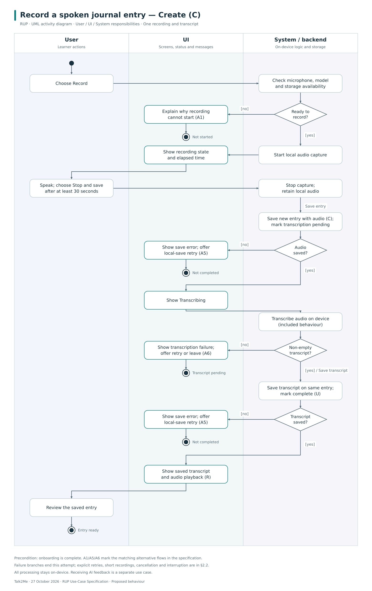
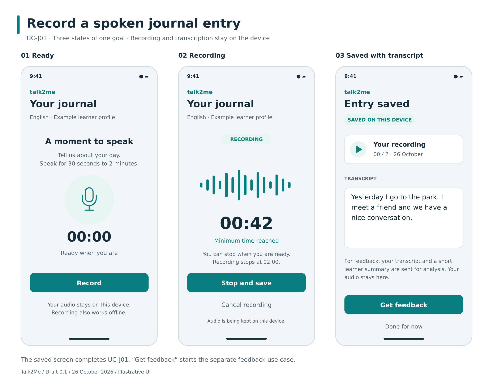

# Talk2Me — Use-Case Specification

**UC-J01: Record a spoken journal entry**  
Version 0.3 — draft for team review

**CRUD: Create (C) — journal entry.**

## Revision History

| Date | Version | Description | Prepared by |
| --- | --- | --- | --- |
| 2026-10-26 | 0.1 | Initial specification and visuals; subsequently uploaded by the team | ChatGPT, for Team Talk2Me |
| 2026-10-27 | 0.2 | Verified RUP outline; expanded explicit CRUD labels; linked onboarding prerequisite | ChatGPT, for Team Talk2Me |
| 2026-10-27 | 0.3 | Rechecked teacher examples; added User/UI/System swimlanes, Save labels and visible RUP identification | ChatGPT, for Team Talk2Me |

## 1. Use-Case Name

**Record a spoken journal entry**

| Field | Definition |
| --- | --- |
| Documentation standard | **RUP Use-Case Specification:** sections 1–6; brief description deferred as permitted by the teacher |
| Identifier | UC-J01 |
| Primary actor | Learner who has completed local onboarding |
| Goal | Save one spoken journal entry with its transcript on the device |
| Trigger | The learner chooses to record a new entry |
| Scope | Talk2Me mobile app; December delivery |
| CRUD classification | **Create (C) — Journal entry.** Recording and transcription produce one new entry; this is not a combined Create/Read/Update/Delete management use case. |
| Included behaviour | Transcribe audio entry — SRS 3.1.3 |
| SRS traceability | [SRS 3.1.2–3.1.3](https://github.com/hwnest25/talk2me/blob/04941a6c6d483d5e880726dcab42ce00f5e72737/docs/SoftwareRequirementsSpecification.md#31-functionality) |

The actor is the SRS's **Learner**. Completing onboarding does not require an external account. Editing or deleting completed entries, viewing history, and requesting AI feedback are outside this goal. [UC-F01](UC-F01_ReceiveLanguageFeedback.md) may be started separately after a transcript is ready.

### 1.1 Brief Description

Deferred until the `.feature` work, as permitted by the assignment.

## 2. Flow of Events

### 2.1 Basic Flow

1. The learner selects **Record** on the journaling screen.
2. Talk2Me checks microphone access, local transcription availability, and available storage. It starts recording locally and displays the elapsed time.
3. The learner speaks in the target language. Talk2Me indicates that recording is active.
4. After at least 30 seconds, the learner selects **Stop and save**. Talk2Me stops recording. Under the draft's two-minute limit, it also stops automatically at 02:00.
5. Talk2Me saves the recording locally as one entry, with an identifier, date, duration, target language, and a transcription-pending status.
6. Talk2Me automatically performs the included **Transcribe audio entry** behaviour on the device. The learner does not submit a separate transcription request.
7. Talk2Me saves the resulting non-empty transcript against that same entry and marks transcription as complete.
8. Talk2Me displays the saved transcript and local audio playback. The entry is ready for a separate feedback request. The use case ends successfully without sending audio or text to a server.

The automatic two-minute stop and explicit feedback request are draft design decisions; see [review assumptions A1–A2](../../REVIEW.md#design-decisions-and-assumptions).

#### CRUD operations in this use case

| Operation | Role in this goal | Where it occurs |
| --- | --- | --- |
| **Create (C)** | Primary operation: create one journal entry | Basic flow, step 5 |
| **Read (R)** | Supporting operation: display the new transcript and play saved audio | Basic flow, step 8 |
| **Update (U)** | Supporting operation: attach the transcript and change transcription status on that same new entry | Basic flow, step 7; transcription recovery |
| **Delete (D)** | No deletion of completed entries in this use case | A3 discards unfinished work only; deleting an existing entry is a separate goal |

The supporting operations do not turn this into a general “Manage entries” use case. Editing a completed transcript is outside scope.

#### 2.1.1 Activity Diagram

[Editable SVG](assets/UC-J01_activity.svg)

The diagram shows the main flow and principal decision paths. The alternatives below also cover interruption and recovery details.

**Responsibility swimlanes:**

| Lane | Responsibility |
| --- | --- |
| **User** | Start recording, speak, stop and review the entry |
| **UI** | Show recording/transcription state, errors, transcript and playback |
| **System / backend** | Capture and transcribe audio and save the entry on-device |

These follow the teacher's User/System/UI partitioning. “System / backend” means the logic and data layer; it does not imply that all processing runs on a remote server. The diagram labels processing location where it matters.

**RUP** is named in the diagram heading. UML activity notation supplies the swimlanes, actions, decisions and initial/final nodes. **Save** labels identify persistence transitions; they do not add a separate Save button where the written flow saves automatically.

[Editable draw.io diagrams — UC-J01 page](assets/Talk2Me_Activity_Diagrams.drawio)

#### 2.1.2 Mockup

[Editable SVG](assets/UC-J01_mockup.svg)

The three screens show the progression through one entry. English and the sample transcript are illustrative. **Get feedback** starts UC-F01; it is not part of recording. The mockup does not add history, prompt selection, or other later-phase features.

### 2.2 Alternative Flows

#### 2.2.1 A1 — Recording cannot start

At step 2, microphone permission is denied, the microphone is unavailable, the transcription model is not ready, or storage is insufficient. Talk2Me explains the relevant problem and does not start recording. The learner can resolve it and retry step 2, or leave. No completed entry is created.

#### 2.2.2 A2 — Entry is too short

At step 4, selecting **Stop and save** before 30 seconds is unavailable. Talk2Me shows how much more recording time is needed and continues capturing audio. The learner can continue to step 4 or cancel using A3.

#### 2.2.3 A3 — Learner cancels

Before step 5, the learner selects **Cancel recording**. Talk2Me asks whether to discard the current recording. Keeping it returns to the current recording state. Confirming discards only this unfinished recording and ends the use case without a new completed entry.

#### 2.2.4 A4 — Recording is interrupted

If a call, app interruption, or unexpected termination stops capture, Talk2Me retains recoverable audio locally and clearly marks it as unfinished. On recovery, the learner can confirm an entry of at least 30 seconds and continue at step 5, or discard it and start a new attempt. A shorter recovered recording is not presented as a completed entry. Existing entries remain unchanged.

#### 2.2.5 A5 — A local save fails

At step 5 or 7, Talk2Me does not announce a successful save. It explains the failure and keeps any recoverable recording or transcript available for another local save attempt. A successful retry resumes at the following step without creating a duplicate entry. If recovery cannot be guaranteed, that limitation is stated to the learner; existing saved entries remain intact.

#### 2.2.6 A6 — Transcription fails or contains no recognised speech

At step 6 or 7, Talk2Me keeps the saved audio, marks the entry as needing transcription, and explains the problem. The learner can retry step 6 or leave with the recording saved. No feedback request is available until a non-empty transcript exists. Recording another entry is a new execution of UC-J01.

## 3. Special Requirements

- **Local processing:** Recording, transcription, and saving work offline once the model is available. Audio never leaves the device. No transcript is transmitted in this use case. SRS 3.3.1, 3.6.1 and 3.9.4.
- **Duration:** The minimum completed recording is 30 seconds, per SRS 3.2.3. The two-minute automatic stop is a proposed interpretation of the range in SRS 2.1.
- **Performance target:** A two-minute entry should transcribe within 10 seconds on a 2022-or-later device, per SRS 3.4.1. This is an inherited requirement, not a measured result.
- **Data integrity:** Save the audio before transcription; use transactional database writes and recoverable local recording storage. Do not overwrite earlier entries. SRS 3.3.2. Recovery limits during a crash or storage exhaustion require implementation testing.
- **Usability:** Show recording, processing, saved, and failure states distinctly. Display the original transcript without silently replacing it with AI-corrected text.
- **Platform:** iOS 15+ and Android 10+, using the mandated Flutter frontend, per SRS 3.6.2.

## 4. Preconditions

1. The learner has completed [UC-O01: Set up a learner profile](UC-O01_SetUpLearnerProfile.md), with a target language and a local learner profile.
2. The journaling screen is accessible on a supported device.

Internet access and an external account are not preconditions. Microphone permission, model readiness, and storage are checked in the flow so their failures are handled explicitly.

## 5. Postconditions

### 5.1 Success

One new journal entry is saved locally with its audio, metadata, and transcript. The learner can read the transcript, play the audio, and choose to request feedback. No entry data has been transmitted.

### 5.2 Cancellation or Failure

Existing entries remain unchanged. Confirmed cancellation removes only the unfinished recording. If recording was saved but transcription failed, the entry remains marked as needing transcription. Other recoverable work is retained where possible, without being labelled successfully saved.

## 6. Extension Points

None defined for this version. **Transcribe audio entry** is mandatory included behaviour on the successful flow, not an extension. **Receive language feedback** is a separate user goal and does not have to occur for this use case to succeed.
