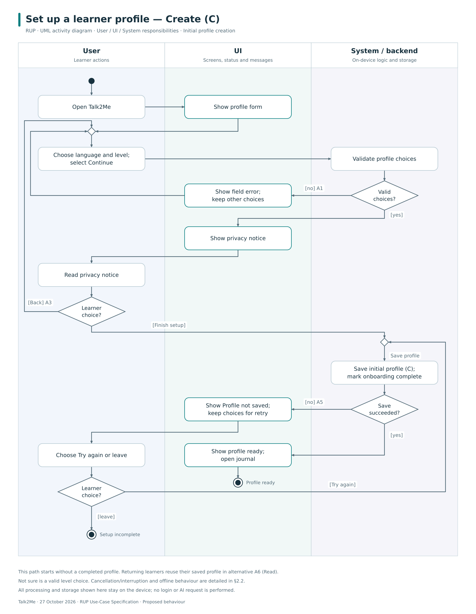
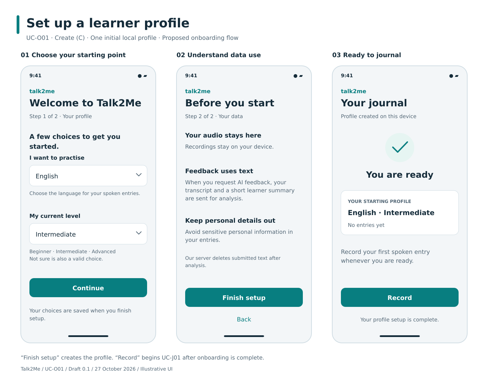

# Talk2Me — Use-Case Specification

**UC-O01: Set up a learner profile (onboarding)**  
Version 0.2 — draft for team review

**CRUD: Create (C) — initial learner profile.**

## Revision History

| Date | Version | Description | Prepared by |
| --- | --- | --- | --- |
| 2026-10-27 | 0.1 | Initial onboarding specification, mockup and activity diagram | ChatGPT, for Team Talk2Me |
| 2026-10-27 | 0.2 | Rechecked teacher examples; added User/UI/System swimlanes, Save labels and visible RUP identification | ChatGPT, for Team Talk2Me |

## 1. Use-Case Name

**Set up a learner profile**

| Field | Definition |
| --- | --- |
| Documentation standard | **RUP Use-Case Specification:** sections 1–6; brief description deferred as permitted by the teacher |
| Identifier | UC-O01 |
| Primary actor | New Learner setting up Talk2Me on this device |
| Goal | Create an initial local learner profile so the learner is ready to start journaling |
| Trigger | The learner opens Talk2Me for initial setup |
| Scope | Talk2Me mobile app; December onboarding scope in SRS 3.1.1 |
| CRUD classification | **Create (C) — Learner profile.** The main flow creates one initial profile; later editing and deletion are separate goals. |
| Supporting actor | None; setup uses local data and does not call an external service |
| SRS traceability | [3.1.1 Onboard and set up profile](../SoftwareRequirementsSpecification.md#31-functionality); 3.2.1, 3.3.2, 3.6.3, 3.7, 3.9.1 and 3.11 |

Onboarding is the path to the single goal of creating a usable profile. Registration, login, recording an entry, requesting feedback, and later profile management are outside this use case. The SRS rules out requiring an external account but does not settle Talk2Me-specific authentication. This draft uses the SRS's Learner actor and local-profile model; see the [open scope decisions](../../REVIEW.md#design-decisions-and-assumptions).

### 1.1 Brief Description

Deferred until the `.feature` work, as permitted by the assignment.

## 2. Flow of Events

### 2.1 Basic Flow

1. The learner opens Talk2Me to begin setup.
2. Talk2Me checks for a completed local profile. In the main flow none exists, so it displays a short welcome and profile form.
3. The learner selects a supported target language and a self-assessed level. Proposed level choices are **Beginner**, **Intermediate**, **Advanced**, and **Not sure**. If only one target language is supported, it is shown preselected for confirmation.
4. The learner selects **Continue**.
5. Talk2Me checks that a supported language and a valid level choice have been supplied.
6. Talk2Me displays a short privacy notice: recordings stay on the device; requesting AI feedback later sends the transcript and a compact learner-profile summary for analysis; the Talk2Me backend must not retain submitted text after processing. It advises the learner to avoid sensitive personal information in entries. No entry or profile data is transmitted during setup.
7. The learner selects **Finish setup** to confirm the displayed choices and that they have seen the notice. This action does not request feedback or grant consent to future features.
8. Talk2Me saves one local profile containing the target language and self-assessed level, initialises empty learning/session history, and marks onboarding complete in the same successful save. Repeated taps must not create duplicates.
9. Talk2Me confirms that the profile is ready and opens the empty journaling screen. The use case ends successfully. Choosing **Record** later starts [UC-J01](UC-J01_RecordSpokenJournalEntry.md).

The level choices, **Not sure** option, local offline setup, and two-screen arrangement are proposed design choices, not existing implementation. Detailed learning-goal setting is deferred because SRS 3.1.13 assigns it to Phase 2, although SRS 3.9.1 also mentions it during onboarding. This conflict remains recorded in the review.

#### CRUD operations in this use case

| Operation | Role in this goal | Where it occurs |
| --- | --- | --- |
| **Create (C)** | Primary operation: create the initial learner profile | Basic flow, step 8 |
| **Read (R)** | Supporting operation: check whether setup is already complete and show the stored profile summary | Step 2; alternative A6 |
| **Update (U)** | No editing of an existing saved profile | Changing unsaved selections before step 8 is still part of Create |
| **Delete (D)** | No deletion of a saved profile | Cancelling unfinished setup discards only unsaved input |

#### 2.1.1 Activity Diagram

[Editable SVG](assets/UC-O01_activity.svg)

The diagram shows initial profile creation, validation, returning to the form, and local-save retry or exit. The returning-learner Read path (A6), cancellation and interrupted-save recovery are described below.

**Responsibility swimlanes:**

| Lane | Responsibility |
| --- | --- |
| **User** | Choose profile values, read the notice, finish setup, retry or leave |
| **UI** | Show the form, privacy notice, field errors and completion state |
| **System / backend** | Validate choices and save the profile on-device |

These follow the teacher's User/System/UI partitioning. “System / backend” means the logic and data layer; it does not imply that all processing runs on a remote server. The diagram labels processing location where it matters.

**RUP** is named in the diagram heading. UML activity notation supplies the swimlanes, actions, decisions and initial/final nodes. **Save** labels identify persistence transitions; they do not add a separate Save button where the written flow saves automatically.

[Editable draw.io diagrams — UC-O01 page](assets/Talk2Me_Activity_Diagrams.drawio)

#### 2.1.2 Mockup

[Editable SVG](assets/UC-O01_mockup.svg)

English and Intermediate are illustrative selections. The first two screens perform setup; the third confirms completion and offers the separate recording goal. No email, password, microphone permission, or learning-goal form is required in this proposed flow.

### 2.2 Alternative Flows

#### 2.2.1 A1 — A required selection is missing or invalid

At step 5, Talk2Me identifies the affected field, explains what to choose, and keeps the other selections. No profile is created. The learner corrects the form and resumes at step 3, or leaves using A4. Unsupported or unavailable languages cannot be saved.

#### 2.2.2 A2 — The learner does not know their level

At step 3, the learner selects **Not sure**. This is valid input. Talk2Me stores the level as unspecified rather than inventing a proficiency assessment. The flow continues at step 4. No placement test is required for this draft.

#### 2.2.3 A3 — The learner changes their choices

At step 6, the learner selects **Back**. Talk2Me restores the form with its current selections. The flow resumes at step 3. These are unsaved choices, not an Update operation on a saved profile.

#### 2.2.4 A4 — Setup is cancelled or interrupted

Before step 8 succeeds, the learner can leave the app. No completed profile is claimed; unsaved form choices may be lost. Opening the app again restarts at step 1. If interruption occurs during saving, Talk2Me checks the committed state on reopening: a successfully saved profile follows A6, while an uncommitted write leaves onboarding incomplete. It must not create a duplicate or partially completed profile.

#### 2.2.5 A5 — The profile cannot be saved

At step 8, storage is unavailable or the write fails. Talk2Me shows **Profile not saved**, retains the choices while the app remains open, and offers **Try again**. Retrying returns to step 8 without submitting anything to a server. The learner may instead leave using A4. The app never shows a completed profile until saving succeeds; existing data remains unchanged.

#### 2.2.6 A6 — A completed profile already exists (Read / R)

At step 2, Talk2Me loads the existing profile and opens the journaling screen. This setup attempt ends without creating or overwriting a profile. Editing the saved profile requires a separate use case.

#### 2.2.7 A7 — The device is offline

The flow continues unchanged using the supported-language options, notice and local storage available in the app. Setup does not request AI feedback, download a language model, or require an external login. Microphone and transcription readiness are checked separately when UC-J01 starts.

## 3. Special Requirements

- **Usability:** Keep the screens short and self-explanatory. SRS 3.2.1 targets onboarding plus the first recording within two minutes; this is a product target, not a tested result or a two-minute allowance for setup alone. SRS 3.7 requires self-explanatory onboarding.
- **Local storage:** Save the profile and completion state together using transactional storage, consistent with SRS 3.3.2 and 3.6.3. Do not initialise fabricated scores, errors, or past sessions.
- **Privacy:** Explain the future feedback data flow before completing setup. This use case transmits no learner data and requests no microphone permission. The notice describes required backend behaviour, not verified external-provider retention settings; those remain an implementation check.
- **Minimal data:** The draft requires only a target language and level choice. **Not sure** remains an unspecified level. No real name, email, password or payment information is needed for this local-profile goal.
- **Scope:** Goal configuration, notification preferences, profile synchronisation and subsequent profile editing are outside this use case. The exact supported languages and level labels require team confirmation.

## 4. Preconditions

1. Talk2Me is installed and can open on a supported device.
2. The app includes the profile form, supported-language choices and privacy notice needed for setup.

The main flow assumes no completed local profile; A6 handles a returning learner. Internet access, an external account, microphone permission and a downloaded transcription model are not preconditions for profile creation. Storage failures are handled within the flow.

## 5. Postconditions

### 5.1 Success

Exactly one initial learner profile is saved locally with a supported target language and a level choice, or an explicitly unspecified level. Learning and session history are empty, onboarding is marked complete, and the journaling screen is available. No recording or feedback has been created and no learner data has left the device.

For A6, the existing profile remains unchanged and available; no new profile is created.

### 5.2 Cancellation or Failure

If no save committed, onboarding remains incomplete and no partial profile is presented as ready. Unsaved choices can be retried while available or entered again. Existing saved information remains intact. If a save committed before interruption, the completed profile is reused on reopening.

## 6. Extension Points

None defined in this version. The privacy notice and initial profile choices are part of setup. Recording an entry, registering an account, changing a profile, and setting Phase 2 learning goals are separate goals, not mandatory extensions of this flow.
