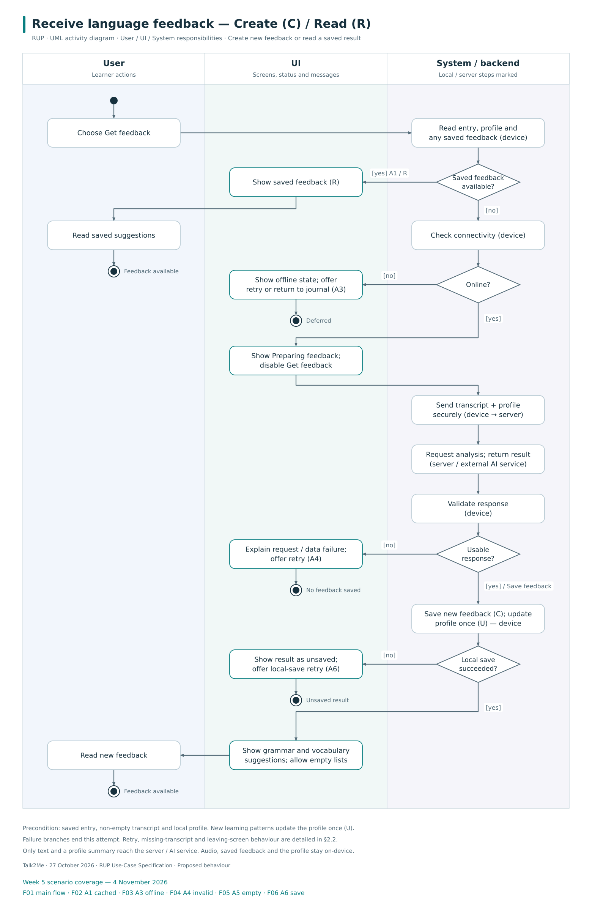
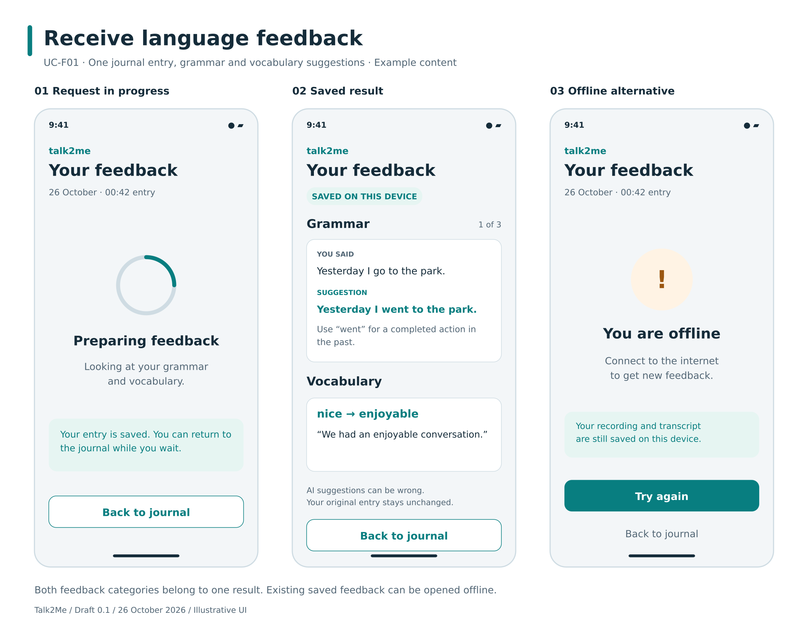

# UC-F01 — Receive language feedback

RUP use-case specification · Draft v0.5 · 11 November 2026. Revision history is in Git.

## 1. Use-Case Name

**Receive language feedback.** Obtain grammar and vocabulary suggestions for one saved entry, or read its existing feedback.

- **Actor / trigger:** Learner selects **Get feedback**. Supporting actor: external AI feedback service (Anthropic Claude).
- **CRUD:** Create (C) new feedback — primary; Read (R) saved feedback in A1; supporting Update (U) records learning patterns once. Delete (D) is outside scope.
- **Traceability:** [SRS 3.1.4–3.1.5](../SoftwareRequirementSpecification.md#31-functionality).

Grammar and vocabulary form one user goal here. The overall diagram still represents them separately; that alignment remains an open design decision. Pronunciation, settings and history browsing are outside this use case.

## 2. Flow of Events

### 2.1 Basic Flow

1. The learner selects **Get feedback** for the current entry.
2. Talk2Me checks for a non-empty transcript and local profile. This main flow assumes no saved feedback.
3. Talk2Me checks connectivity, shows a pending state and prevents duplicate submissions for the entry.
4. It sends only the transcript and compact profile summary over HTTPS to the backend, which requests grammar and vocabulary analysis. Audio stays local.
5. Talk2Me validates the structured response and both categories. Empty suggestion lists are valid.
6. It saves feedback against the entry, applies learning patterns to the profile once and marks feedback available.
7. It displays original wording, corrections and plain-language explanations, plus contextual vocabulary suggestions. Empty categories say no suggestions were returned.
8. The learner reads the result. Original audio and transcript remain unchanged.

### 2.2 Alternative Flows

| Flow | Behaviour |
| --- | --- |
| **A1 — Saved feedback (Read)** | At step 2, load it and continue at step 7. No network request or repeated profile update. |
| **A2 — Missing transcript** | Explain that transcription must finish. Return to [UC-J01 recovery](UC-J01_RecordSpokenJournalEntry.md); send no request. |
| **A3 — Offline** | Explain that new feedback needs internet. Preserve the entry; retry the connectivity check or leave. No automatic background submission is assumed. |
| **A4 — Failed/timeout/unusable response** | At step 4 or 5, show failure and offer **Try again** from step 3 or **Back to journal**. Accept one result only; obsolete responses must not overwrite it or attach to another entry. |
| **A5 — Empty suggestions** | At step 5, accept a valid empty grammar or vocabulary list and continue. Do not invent corrections or claim error-free speech. |
| **A6 — Save fails** | At step 6, retain the result temporarily where possible, mark it unsaved and offer a local save retry without another AI request. Preserve prior profile/entry data. A lost unsaved result may require a new request. |
| **A7 — Learner leaves** | An active request may finish and save to its originating entry while the app remains active. Otherwise leave feedback unavailable for later retry. Leaving does not retract submitted text. |

### 2.3 Activity Diagram and Narrative

[Read the Gherkin narrative](../../features/receive_language_feedback.feature) · [Scenario coverage F01–F06](../acceptance-specifications/Scenario_Mapping.md)

The User/UI/System diagram covers creation, saved reading, offline use, invalid responses and save failure. Retry/late-response details remain above; the scenarios check recovery offers rather than complete retry loops. Step definitions are pending.

[SVG](assets/UC-F01_activity.svg) · [draw.io source](assets/Talk2Me_Activity_Diagrams.drawio)

### 2.4 Mockup

[Editable SVG](assets/UC-F01_mockup.svg). Suggestions are illustrative and read-only. This narrower December mockup omits pronunciation, register and fluency scores.

## 3. Special Requirements

Transmit text/profile summary securely; never audio. The backend must not log or retain submitted text after processing. External-provider retention settings still need verification.

Show understandable suggestions, not guaranteed facts; do not infer pronunciation from text. Target: display feedback within **8 seconds of transcript submission** under normal network conditions. This is unmeasured and is not a timeout threshold. Preserve a visible pending state when it takes longer.

Keep entries intact during failures. Save feedback/profile changes consistently and prevent duplicate updates. The explicit request and combined result remain draft design choices.

## 4. Preconditions

The learner completed [UC-O01](UC-O01_SetUpLearnerProfile.md), has a local profile and a saved entry with a non-empty transcript, and has seen the data-flow notice. A2 handles stale entry state. Saved feedback works offline; no external account is required.

## 5. Postconditions

**Success:** Feedback is saved and displayed, including explicit empty categories where applicable. New feedback updates learning patterns once; original entry data is unchanged.

**Failure/deferred:** The entry and prior profile stay intact. Failed/offline requests are not called complete; received but unsaved results are labelled accordingly. A7 may complete later.

## 6. Extension Points

None. Grammar and vocabulary are both part of the successful result; feedback is separate from saving an entry.
