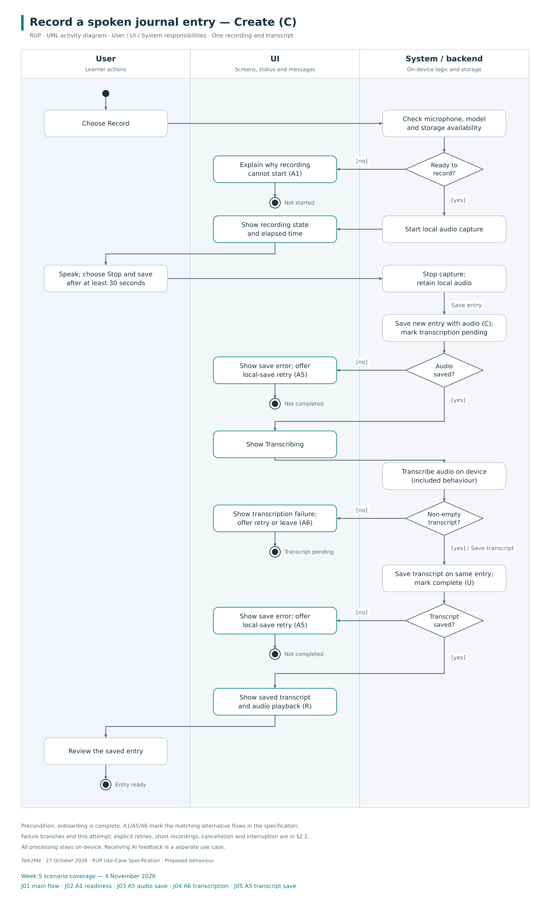
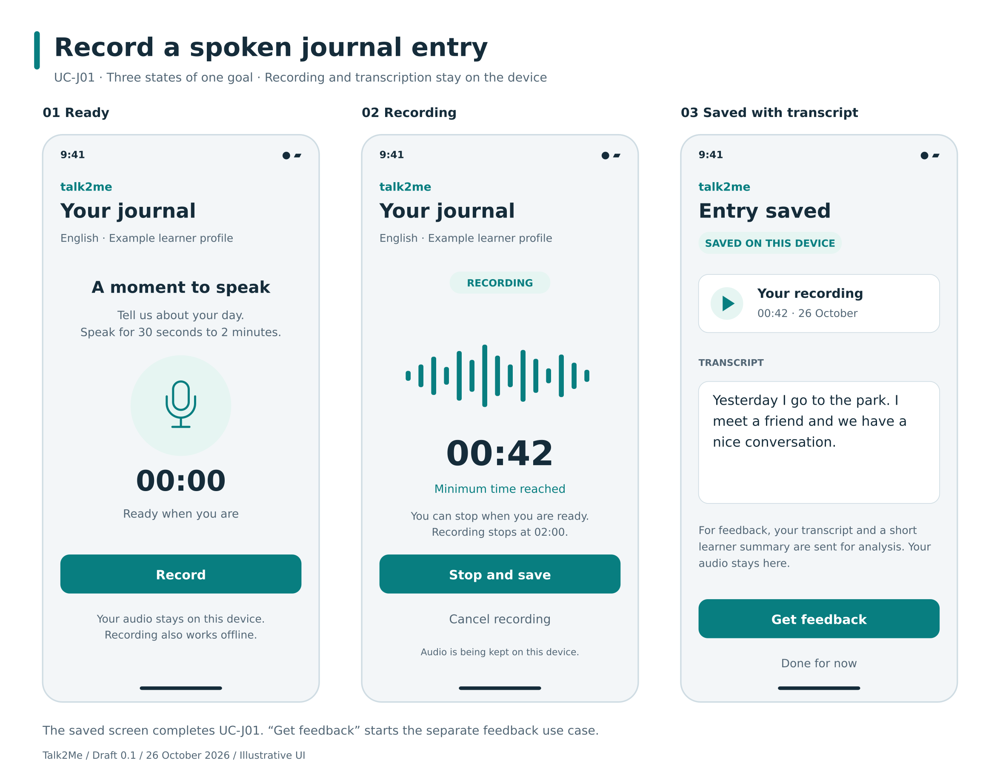

# UC-J01 — Record a spoken journal entry

RUP use-case specification · Draft v0.5 · 11 November 2026. Revision history is in Git.

## 1. Use-Case Name

**Record a spoken journal entry.** Save one recording and its transcript on the device.

- **Actor / trigger:** Learner with a local profile selects **Record**.
- **CRUD:** Create (C) entry — primary; Read (R) for playback; supporting Update (U) attaches its transcript/status. Delete (D) and editing completed entries are outside scope.
- **Included behaviour:** Transcribe audio entry.
- **Traceability:** [SRS 3.1.2–3.1.3](../SoftwareRequirementSpecification.md#31-functionality).

## 2. Flow of Events

### 2.1 Basic Flow

1. The learner selects **Record** on the journal screen.
2. Talk2Me checks microphone access, local model readiness and storage, then starts local recording and an elapsed-time display.
3. The learner speaks; the interface shows that recording is active.
4. After at least 30 seconds, the learner selects **Stop and save**. The draft also proposes automatic stopping at two minutes.
5. Talk2Me saves one local entry with audio, identifier, date, duration, target language and transcription-pending status.
6. Talk2Me automatically transcribes the saved audio on-device.
7. Talk2Me saves the non-empty transcript to the same entry and marks transcription complete.
8. The learner can read the transcript and play the audio. [UC-F01](UC-F01_ReceiveLanguageFeedback.md) may be requested separately. No audio or text is transmitted here.

### 2.2 Alternative Flows

| Flow | Behaviour |
| --- | --- |
| **A1 — Not ready** | At step 2, explain denied/unavailable microphone, missing model or insufficient storage. Do not record. Resolve and retry step 2, or leave. |
| **A2 — Too short** | Before 30 seconds, **Stop and save** is unavailable. Show the remaining time and keep recording; cancellation remains available. |
| **A3 — Cancel** | Before step 5, **Cancel recording** asks for confirmation. Keeping returns to recording; confirming discards only the unfinished recording. |
| **A4 — Interrupted** | Retain recoverable audio and mark it unfinished. On recovery, a recording of at least 30 seconds can be confirmed and saved at step 5; otherwise discard/restart. Preserve existing entries. |
| **A5 — Local save fails** | At step 5 or 7, show failure without a success message. Retain recoverable audio/transcript and offer a local retry. Resume after a successful save without duplication; explain any recovery limit. |
| **A6 — Transcription fails/empty** | Keep saved audio and mark transcription pending. Retry step 6 or leave. Feedback remains unavailable until a non-empty transcript exists. |

### 2.3 Activity Diagram and Narrative

[Read the Gherkin narrative](../../features/record_journal_entry.feature) · [Scenario coverage J01–J05](../acceptance-specifications/Scenario_Mapping.md)

User/UI/System lanes separate actions, presentation and local processing. The diagram shows principal decision paths; interruption and recovery details remain above. The scenarios check recovery offers, not complete retry loops. Step definitions are pending.

[SVG](assets/UC-J01_activity.svg) · [draw.io source](assets/Talk2Me_Activity_Diagrams.drawio)

### 2.4 Mockup

[Editable SVG](assets/UC-J01_mockup.svg). Screen content is illustrative.

## 3. Special Requirements

- Recording, transcription and saving work offline once the model is available. Audio stays local; this flow also sends no transcript.
- Minimum completed duration: **30 seconds**. The **two-minute automatic stop remains a proposed design choice**.
- Target: transcribe a two-minute entry within **10 seconds** on a 2022-or-later device; not yet measured.
- Save audio before transcription; use transactional writes and recoverable storage. Test crash/storage-exhaustion recovery limits. Never silently rewrite the transcript.
- Show recording, processing, saved and failed states distinctly. Platform: Flutter, iOS 15+ and Android 10+.

## 4. Preconditions

The learner completed [UC-O01](UC-O01_SetUpLearnerProfile.md), has a local profile and target language, and can access the journal. Internet and an external account are unnecessary. Readiness checks occur inside the flow.

## 5. Postconditions

**Success:** One local entry contains audio, metadata and transcript, ready for playback and a separate feedback request. No entry data was transmitted.

**Failure/cancellation:** Existing entries are unchanged. Confirmed cancellation removes unfinished work only. Saved audio with failed transcription stays pending; other recoverable work is retained without claiming success.

## 6. Extension Points

None. Transcription is mandatory included behaviour on success. Feedback is a separate user goal.
