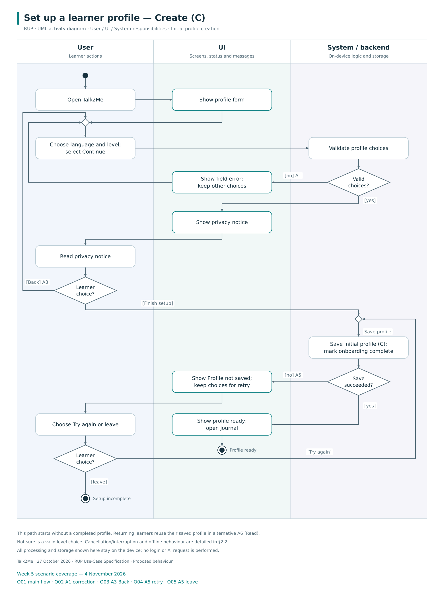
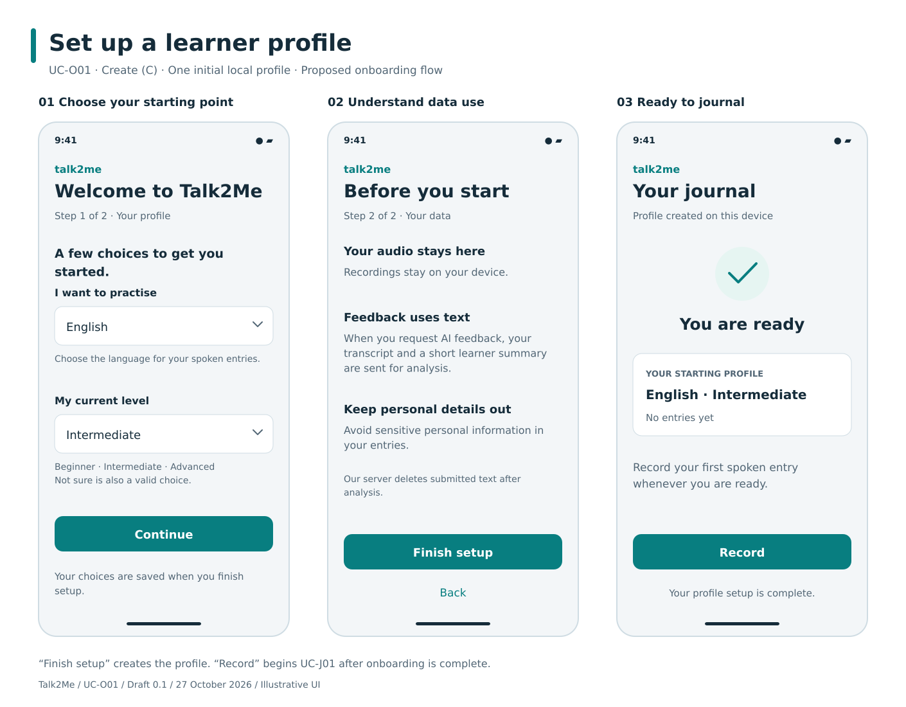

# UC-O01 — Set up a learner profile

RUP use-case specification · Draft v0.4 · 11 November 2026. Revision history is in Git.

## 1. Use-Case Name

**Set up a learner profile.** A new learner selects a language and level, reads the privacy notice, and creates one local profile.

- **Actor / trigger:** New learner opens Talk2Me for initial setup.
- **CRUD:** Create (C) profile — primary; Read (R) existing profile in A6. Changing unsaved choices is not Update (U); saved-profile Update (U) and Delete (D) are outside scope.
- **Traceability:** [SRS 3.1.1](../SoftwareRequirementSpecification.md#31-functionality).

## 2. Flow of Events

### 2.1 Basic Flow

1. The learner opens Talk2Me.
2. Talk2Me checks for a completed profile. If none exists, it shows the welcome and profile form.
3. The learner selects a supported language and level: Beginner, Intermediate, Advanced or Not sure. A sole supported language is preselected for confirmation.
4. The learner selects **Continue**.
5. Talk2Me validates both choices.
6. The privacy notice explains that audio stays local; later feedback sends the transcript and compact profile summary; the backend must not retain submitted text. It advises against sensitive personal information.
7. The learner selects **Finish setup**, confirming the choices and acknowledging the notice. This does not request feedback or consent to future features.
8. Talk2Me saves the profile, empty learning/session history and completion state together. Repeated taps must not create duplicates.
9. Talk2Me confirms success and opens the empty journal. Recording later starts [UC-J01](UC-J01_RecordSpokenJournalEntry.md).

### 2.2 Alternative Flows

| Flow | Behaviour |
| --- | --- |
| **A1 — Invalid selection** | At step 5, show the affected field and retain other choices. Correct the form from step 3 or leave through A4. Unsupported languages cannot be saved. |
| **A2 — Level unknown** | At step 3, **Not sure** saves an unspecified level; no assessment is invented. Continue at step 4. |
| **A3 — Change choices** | From the notice, **Back** restores the current form values; resume at step 3. |
| **A4 — Cancel or interrupt** | Before a save commits, setup remains incomplete; unsaved choices may be lost. On reopening, reuse a committed profile through A6 or restart setup. Never present a partial profile as ready. |
| **A5 — Save fails** | Show **Profile not saved**, retain choices while available, and offer **Try again** at step 8 or leave through A4. Keep existing data intact. |
| **A6 — Existing profile (Read)** | At step 2, load the existing profile and open the journal without creating or overwriting it. |
| **A7 — Offline** | Continue with bundled choices and local storage. Setup needs no external login, model download or feedback service. |

### 2.3 Activity Diagram and Narrative

[Read the Gherkin narrative](../../features/onboarding_profile.feature) · [Scenario coverage O01–O05](../acceptance-specifications/Scenario_Mapping.md)

The diagram covers validation, Back and save retry/exit. Additional alternatives remain specified above. User/UI/System lanes separate interaction, presentation and local application logic. Step definitions are pending.

[SVG](assets/UC-O01_activity.svg) · [draw.io source](assets/Talk2Me_Activity_Diagrams.drawio)

### 2.4 Mockup

[Editable SVG](assets/UC-O01_mockup.svg). English and Intermediate are sample choices.

## 3. Special Requirements

Save profile and completion state transactionally. Send no learner data and request no microphone permission during setup. Do not invent initial scores or history. The SRS target is onboarding **plus first recording within two minutes**; it has not been measured.

**Open design choices:** supported languages, level labels, Not sure and the two-screen arrangement need team confirmation. Learning-goal setup is deferred in this draft; the SRS records the original scope conflict. External-provider retention requires implementation verification.

## 4. Preconditions

Talk2Me opens on a supported device and includes the form, language choices and notice. Internet, external account, microphone access and transcription model are not prerequisites; storage failure is handled in the flow.

## 5. Postconditions

**Success:** One completed local profile exists, with the chosen language/level and empty history; the journal is available. A6 reuses the existing profile unchanged. No entry, feedback or data transmission is created.

**Failure/cancellation:** No uncommitted profile is marked complete. Existing data remains intact; a save committed before interruption is reused.

## 6. Extension Points

None. Recording, profile editing, registration and later learning goals are separate goals.
